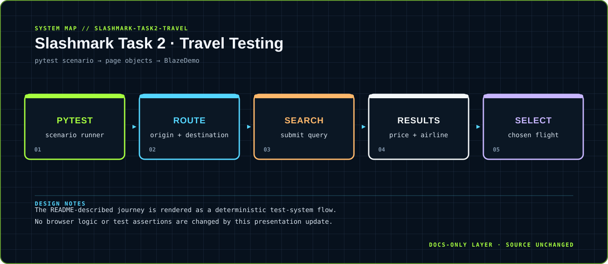

<div align="center">



</div>

# Slashmark Task 2 · Travel Testing

> Browser automation for route selection, flight search and booking-style results.

A Python + Selenium + pytest suite for BlazeDemo flows, modeled as a simple search-to-selection journey.

<div align="center">

`Python · Selenium · pytest` &nbsp;·&nbsp; `route selection → flight search → results → selection`

</div>

## `01 / SYSTEM CARD`

- **Primary boundary:** `pytest scenario → page objects → BlazeDemo`
- **Documentation stance:** architecture and presentation only; application source is intentionally untouched.
- **Visual language:** Y2K terminal grid, brutalist labels, maximalist contrast, readable static SVG fallback.

## `02 / ARCHITECTURE`

The map above is a compact view of the repository's visible runtime boundary. It is designed to answer three questions quickly: where input enters, where policy or domain logic lives, and where external side effects leave the system.


## `03 / DESIGN NOTES`

- The README-described journey is rendered as a deterministic test-system flow.
- No browser logic or test assertions are changed by this presentation update.

This upgrade adds documentation assets only. It does not change source files, dependency manifests, tests, workflows or runtime configuration.

## `04 / EXISTING PROJECT DOCUMENTATION`

<details open>
<summary>Read the original project notes</summary>

# Task 2 — Travel Website Automation Testing

Automated test suite for **BlazeDemo** travel website using Python + Selenium + pytest.

## What's Tested

- **Flight Search** — Route selection, dropdown options, search results
- **Flight Results** — Price display, airline info, flight selection
- **Booking** — Passenger info, payment, confirmation
- **End-to-End** — Full journey from search to booking confirmation

## Setup

```bash
python3 -m venv venv
source venv/bin/activate
pip install -r requirements.txt
```

## Run Tests

```bash
# All tests
pytest

# By category
pytest -m smoke
pytest -m regression

# Generate HTML report
pytest --html=reports/report.html --self-contained-html
```

## Tech Stack

- Python 3 + Selenium 4 + pytest
- Page Object Model design pattern
- Data-driven testing with parameterized fixtures
- WebDriver Manager for automatic browser driver management

## Intern

**M Vignesh Sai** — Slash Mark Internship (June 2026)

</details>

